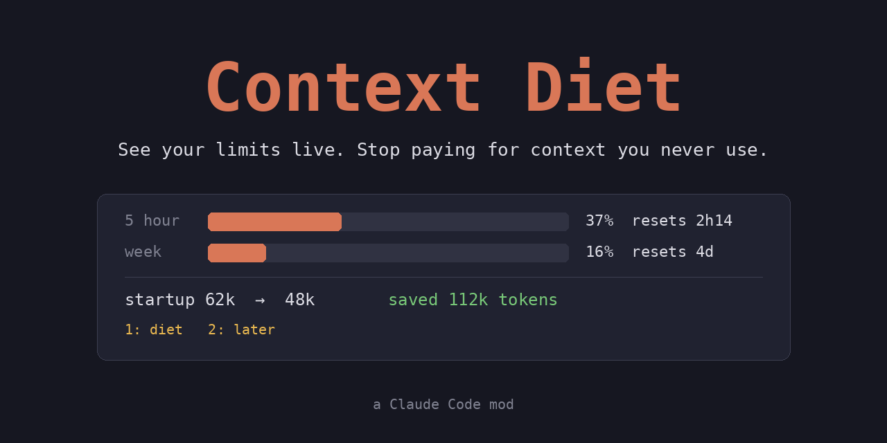
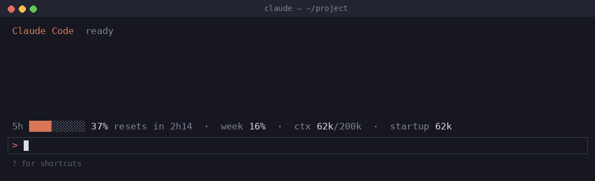

# Context Diet



Two things Claude Code doesn't show you while you work: **how close you are to your limits**, and **how many tokens every request spends before you've typed a word**. Context Diet puts both under your prompt, all the time, and helps you cut the second one.



## What you get

**1. A live gauge under the prompt.** Always on, no command needed:

```
5h ▓▓▓░░░░░ 37% · resets in 2h14 · week 16% · ctx 62k/200k · startup 62k · saved 112k
```

| Part | Meaning |
| --- | --- |
| `5h 37% · resets in 2h14` | Your 5-hour limit, and when it resets. A toast warns you at 80% and 95%. |
| `week 16%` | Your weekly limit |
| `ctx 62k/200k` | How full this conversation's context window is |
| `startup 62k` | What the window holds before your first message: system prompt, tools, MCP servers, skills, CLAUDE.md and memory. **It is re-sent with every request.** |
| `saved 112k` | Tokens you haven't had to send since your first diet |

The numbers come straight from Claude Code. Showing them costs no tokens.

**2. A quiet audit.** For your first 3 sessions it only watches which MCP servers and skill plugins you actually use. After that, if it finds at least 3k startup tokens you load but never touch, one line appears above the prompt:

```
Context Diet: startup is 62k, ~14k of it you don't use (context7 alone is 7k)  1: diet  2: later
```

Press `2` and it leaves you alone for 3 days.

**3. A diet, with your OK.** Press `1` (or type `/diet` any time) and Claude gets the findings as a small JSON file. It doesn't measure anything again.
- The first time, it asks you three questions: how strict, this project or everywhere, and whether it may slim large memory files.
- It shows a menu with the saving next to each item. You tick what goes.
- It disables the servers and plugins you ticked. Configs are never deleted, and anything removed comes with the command to restore it.
- A subagent slims large CLAUDE.md or memory files and keeps a `.bak` backup, so your main conversation never pays to read them.
- Restart Claude Code and the gauge shows the new startup and starts counting savings.

## How much will it save? (honest numbers)

It depends entirely on your setup:

- **Some of the startup can't be cut.** Claude Code's own system prompt and built-in tools are always there, about 30k tokens.
- **Most MCP tools are already cheap.** Claude Code loads many of them on demand ("deferred"), so they cost little until used. Servers that load all their tools up front, unused skill plugins and long CLAUDE.md files are where the fat is.
- **On the author's machine** (a fairly lean setup) the diet cut about **2k** tokens, from ~50k to ~48k. With several always-loaded MCP servers, plugins with dozens of skills or a long CLAUDE.md, you can expect 10k to 30k.
- **Caching makes it smaller than it looks.** Prompt caching makes repeated startup tokens cheaper, so `saved` counts tokens you haven't had to send, not money or limit percentage. A leaner startup still leaves more room in the window, and your first, uncached message of every session is cheaper.

If nothing is worth cutting, Context Diet tells you so and stays out of your way.

## Install

Requires a recent Claude Code with mods support (`claude update`). Inside Claude Code:

```
/plugin marketplace add KemalHub/context-diet
/plugin install context-diet@context-diet
```

On Claude Code 2.1.275 or later this also works in one step: `/plugin install context-diet --marketplace KemalHub/context-diet`.

Restart Claude Code. The gauge appears under the prompt after the first reply.

For a local install from a clone:

```
/plugin marketplace add ./context-diet
/plugin install context-diet@context-diet
```

## Commands

| Command | What it does |
| --- | --- |
| `/diet` | Measure now and start a diet, even during the learning sessions |

Your answers to the three questions are saved in `~/.claude/context-diet/profile.json`. Delete that file to answer them again.

## What it reads and stores

- **Reads:** Claude Code's usage and context numbers (the same breakdown `/context` shows) and the names of the MCP tools and skills you call. It doesn't read your files or prompts and makes no network calls.
- **Stores** (in the plugin's own store): when each server or plugin was last used, the startup tokens before your first diet, the savings counter and the "later" snooze.
- **Model calls:** none, until you press `1` or type `/diet`. After that it's a normal Claude turn using the `context-diet` skill, kept short by design.

## Development

```
claude plugin validate ./plugin --strict   # check the manifest and hooks module
claude --plugin-dir ./plugin               # load it for one session, reloads on save
```

- `plugin/hooks/register.js` holds the gauge, usage log, finder, band, `/diet` and savings counter. Hooks: `session.start`, `session.measure`, `turn.step`, `turn.complete`, `tool.call`, `skill.prompt`, `command.run`, `session.end`, `ui.render`.
- `plugin/skills/context-diet/SKILL.md` covers the questions, the menu, applying changes and the memory-slimming subagent.

## License

MIT, see [LICENSE](LICENSE).
